[](https://doi.org/10.5281/zenodo.18467564)

<h1>
  
  BaseAL - Active Learning Baseline
</h1>


>BaseAL is a framework for developing and evaluating active learning methods. BaseAL (v1) currently focuses on audio and bioacoustic data. 

The tool provides a complete pipeline for evaluating sampling strategies and 3D visualisation.


*Demo of 3D visualisation.*

### Key Features

- **Experiment Management**: Track and compare different active learning configurations
- **Interactive 3D Visualisation**: Explore high-dimensional embeddings using PCA/UMAP reduction with an interactive Three.js interface
- **Multiple Sampling Strategies**: Compare different sampling and diversification strategies
- **Model Integration**: Simulates transfer learning of embeddings using an adjustable classification head.

**For BaseAL compatible dataset generation see the [dataset generator](https://github.com/BenMcEwen1/dataset-generator). This is built on [Bacpipe](https://github.com/bioacoustic-ai/bacpipe) for seamless integration with bioacoustic models

# Setup

### Prerequisites

These instructions assume a new machine. Install the following first:

| Tool | Version | Needed for | Install |
|---|---|---|---|
| git | any recent version | cloning the repository | [git-scm.com/downloads](https://git-scm.com/downloads) |
| [uv](https://docs.astral.sh/uv/) | recent release (tested with 0.9) | Python environment and dependencies | [installation guide](https://docs.astral.sh/uv/getting-started/installation/) |
| Python | 3.11 or 3.12 | running BaseAL | installed by uv if missing, or [python.org](https://www.python.org/downloads/) |
| Node.js and npm | Node 20.19+ or 22.12+ (npm is included) | the optional web app only | [nodejs.org/en/download](https://nodejs.org/en/download) |

Check what you have with `git --version`, `uv --version`, `python --version` and `node --version`. If you don't have a suitable Python, `uv python install 3.12` installs one. Python 3.13 and newer are not supported yet.

If you prefer conda to uv, you need [Miniforge](https://github.com/conda-forge/miniforge) (or another conda distribution) instead of uv; see [Option B](#option-b-conda).

### 1. Clone the Repository

```bash
git clone https://github.com/benmcewen1/BaseAL.git
cd BaseAL
```

### 2. Install the Python Dependencies

#### Option A: uv (recommended)

```bash
uv sync
```

This creates a `.venv` folder with the exact dependency versions recorded in [uv.lock](uv.lock). Activate it with `source .venv/bin/activate` (macOS/Linux) or `.venv\Scripts\activate` (Windows), or select it as the interpreter in VS Code (`Ctrl + Shift + P` → *Python: Select Interpreter*). Alternatively, prefix commands with `uv run` (for example `uv run jupyter lab`) and skip activation.

See the **Dependencies** list in [pyproject.toml](pyproject.toml).

#### Option B: conda

```bash
conda env create -f environment.yml
conda activate baseal
```

[environment.yml](environment.yml) installs PyTorch, FAISS and NumPy from conda-forge so that they share compatible native libraries. Create a **new** environment rather than installing into an existing one: installing BaseAL's dependencies with pip into a conda environment that already contains PyTorch or torchaudio can mix incompatible builds and cause import errors (see [#7](https://github.com/BenMcEwen1/BaseAL/issues/7)).

### Get Started

See the [docs](core/docs/) to get started working with the BaseAL framework, and developing active learning sampling strategies.

The **[API reference](https://benmcewen1.github.io/BaseAL/)** documents the public classes and functions (`ActiveLearner`, `Manager`, the sampling, warm-up and validation strategies, and the visualisation utilities), including their parameters and return values. It is generated from the docstrings with [pdoc](https://pdoc.dev/). To build and preview it locally:

```bash
uv sync --extra docs
uv run pdoc core core.active_learner core.utils api.main -d google
```

### Running Tests

```bash
uv sync --extra test
uv run pytest -v
```

With conda, run `python -m pytest -v` inside the activated `baseal` environment (pytest is included in `environment.yml`).

Tests run against small synthetic embedding datasets generated on the fly (no demo data download required) and cover the sampling strategies, warm-up strategies, the neural network model, the `ActiveLearner`/`Manager` pipeline, and the embedding visualisation utilities in `core/`.

If you are a participating in the BioDCASE data challenge, an `biodcase_example.ipynb` is setup [here](core/docs/biodcase_example.ipynb) with everything needed to get started.

---

### Optional:
The following is **optional** and only required for the web app. It needs Node.js and npm (see [Prerequisites](#prerequisites)).

### 3. Set Up the Frontend (Web Interface)

```bash
cd app
npm install
cd ..
```

`npm audit` reported no known vulnerabilities in the web app's dependencies at the time of the last update. If it reports new advisories after you install, `npm audit fix` usually resolves them; please [open an issue](https://github.com/BenMcEwen1/BaseAL/issues/new/choose) if it doesn't.

## (Optional) Run Web App

### 1. Start the API Server

From the repository root, with the Python environment activated:

```bash
cd api
python main.py
```

(Without activating the environment, use `uv run python main.py` instead of `python main.py`.)

The API will be available at `http://localhost:8000`

You can verify it's running by visiting `http://localhost:8000/docs` for the interactive API documentation.

### 2. Start the Web Interface

Open a new terminal window in the repository root and run:

```bash
cd app
npm run dev
```

The web interface will be available at `http://localhost:5173`

### 3. Explore Embeddings

1. Open `http://localhost:5173` in your browser
2. Click **"Get Started"**.
3. Select **"Use Config File"** and **"Load Config"**, this will select the default options.
4. Use **Run Cycle/Run All Cycles** buttons to step through AL cycles
5. Interact with the 3D scatter plot to explore your data

## To run BaseAL using an Apptainer container on an HPC system, follow these steps:
### 1. Build the Apptainer Image

```bash
cd /path/to/BaseAL
apptainer build --fakeroot baseal.sif apptainer_build/baseal.def
```

### 2. Start shell within the Apptainer container

```bash
apptainer shell --bind /any/required/paths:/mnt baseal.sif
```

### 3. run the same commands as in the setup section above.

## Citation

If you use this software, please cite:
```bibtex
@software{mcewen_baseal,
  author={McEwen, Ben and Zhang, Shiqi},
  title={{BaseAL}: Active Learning Baseline},
  year=2026,
  version={v1.2},
  publisher={Zenodo},
  doi={10.5281/zenodo.21806638},
  url={https://doi.org/10.5281/zenodo.21806638}
}
```

### Contributing, Reporting Issues and Getting Support

Contributions are welcome! See [CONTRIBUTING.md](CONTRIBUTING.md) for how to:

- **get support**: check the [docs](core/docs/) and [API reference](https://benmcewen1.github.io/BaseAL/), then [open a Question issue](https://github.com/BenMcEwen1/BaseAL/issues/new/choose); for private enquiries, email [Ben McEwen](mailto:benmcewen@outlook.com)
- **report a problem**: [open a Bug report issue](https://github.com/BenMcEwen1/BaseAL/issues/new/choose)
- **contribute code or documentation**: fork the repository, make your change on a branch with tests, and open a pull request

Authors of substantial contributions will be recognised as authors in the citable DOI for subsequent releases; see [CONTRIBUTING.md](CONTRIBUTING.md#authorship-and-credit) for details.

## Acknowledgments

BaseAL uses embeddings pre-generated by [Bacpipe](https://github.com/bioacoustic-ai/bacpipe) developed by [Vincent Kather](https://github.com/vskode).
